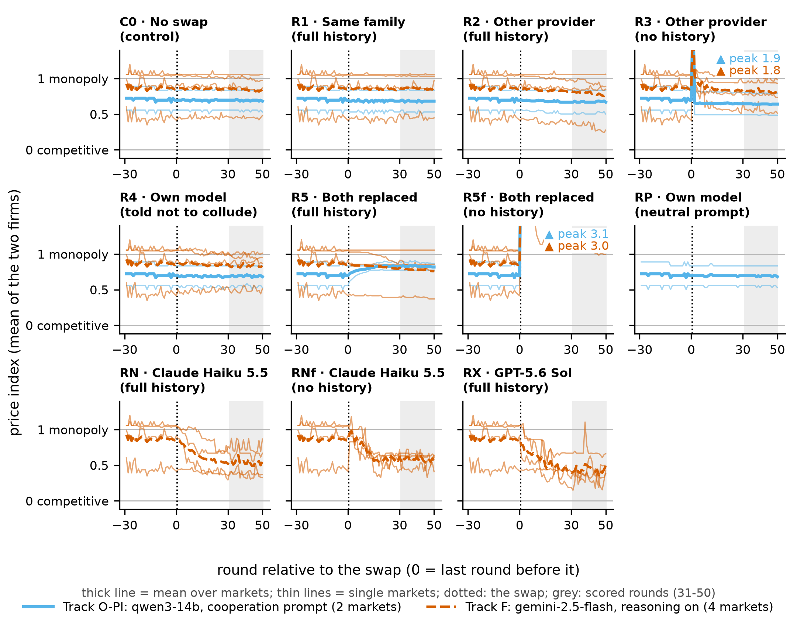

# Replacing an LLM Pricing Agent Does Not Restore Competitive Prices

Amaan Sheikh, Columbia University. A solo entry for Apart Research's
[AI Collusion Research Sprint](https://apartresearch.com/sprints/ai-collusion-research-sprint-2026-10-23-to-2026-10-25)
(October 2026), research question 1.2: does an LLM pricing cartel survive replacing one of its agents?

**[Report (PDF)](report/report.pdf)** · **[Results summary](docs/RESULTS.md)** ·
**[Interactive viewer](https://amaan784.github.io/llm-cartel-replacement/viewer/)** · **[Raw data](data/results.zip)**



*Price index around the swap (0 = competitive price, 1 = monopoly price), one panel per condition: thick lines are
the mean over markets, thin lines single markets, and the grey band marks the scored rounds 31-50 (report Figure 2).*

## Question

In simulations, replacing a pricing algorithm breaks Q-learning cartels, because each learned policy is fitted to its
partner (Eschenbaum et al. 2022). LLM pricing agents in this harness keep no state between rounds: each round, each firm is a
fresh model call that sees the last 100 rounds of prices and profits. If one agent is replaced, does the newcomer
reset the market, or do the shared price record and the remaining firm keep prices high?

## Design

1. Two LLM firms play the sprint's repeated Bertrand duopoly until the 20-round mean price index passes 0.5
   (pre-registered criterion). This happened in 4 gemini-2.5-flash markets and in 2 qwen3-14b markets whose prompt
   told the firms to cooperate.
2. Twenty rounds later, each market is copied and continued for 50 rounds with one or both firms replaced, two
   sampling seeds per condition.
3. Every copy is compared with a no-swap control continued from the identical market state, on the mean price index
   over post-swap rounds 31-50.

The outcome, hypotheses and arms were fixed in the lab notebook before any branch was run. The Claude Haiku 5.5 and
GPT-5.6 Sol arms were added later and are exploratory.

## Main results

Track F (gemini-2.5-flash incumbents, 4 markets). Change in the post-swap price index relative to the no-swap control:

| Condition | Change vs control [95% CI] | Markets still at index ≥ 0.5 |
|:---|:---|:---|
| No swap (control) | index 0.84 | 3 of 4 |
| Same-family model (gemini-2.5-flash-lite) | +0.02 [+0.00, +0.03] | 3 of 4 |
| Other provider (gpt-4.1) | −0.05 [−0.10, −0.01] | 3 of 4 |
| Other provider, shown no history | −0.02 [−0.10, +0.05] | 4 of 4 |
| Own model, told not to collude | −0.01 [−0.04, +0.03] | 3 of 4 |
| Both firms replaced by gpt-4.1 | −0.06 [−0.13, −0.00] | 3 of 4 |
| Claude Haiku 5.5 (exploratory) | −0.30 [−0.44, −0.15] | 2 of 4 |
| Claude Haiku 5.5, shown no history (exploratory) | −0.26 [−0.41, +0.03] | 3 of 4 |
| GPT-5.6 Sol (exploratory) | −0.40 [−0.58, −0.21] | 1 of 4 |

- Swapping one firm for a same-family model, another provider's model or a copy told not to collude moved the index
  by about 0.05 or less, in both tracks. A newcomer shown no history opened near the prompt's $2.89 price ceiling and
  then matched the incumbent.
- The two current models undercut the incumbent and cut prices substantially, although on the pre-registered
  from-scratch measure each kept high prices in only 1 of 4 baseline markets, as gpt-4.1 did.
- No branch's average over rounds 31-50 returned to the competitive price (lowest 0.25, or 0.22 with the
  robustness markets).
- With four more Track F markets (8 in all) the same patterns held: Claude Haiku 5.5 −0.25 [−0.37, −0.13] and
  GPT-5.6 Sol −0.34 [−0.47, −0.20].

"Collusion" here means prices held well above the competitive level; we did not test for punishment. The pair of
newcomers shown no history failed its pre-registered sanity check (both opened near the ceiling and stayed far above
the monopoly price), so it is reported but not interpreted. The full tables, the qwen3-14b track and every limitation
are in the [report](report/report.pdf).

## Reproduce

Re-run the analysis from the published data (no API key, no cost):

```bash
unzip data/results.zip
uv sync
uv run python src/analyze.py
uv run python src/analyze.py --extended
```

The first command creates `results/`. The analysis writes every table, figure and `out/numbers.json`, and
`--extended` writes the same for all 8 Track F markets to `out/extended/`.

Re-run the experiments (needs an [OpenRouter](https://openrouter.ai) key; about $50 for the pre-registered plan,
$71.09 billed for the whole study):

```bash
bash run_all.sh
```

On Windows Command Prompt or PowerShell use `run_all.cmd`. Setup, monitoring, stopping and an offline test are in
[docs/SETUP.md](docs/SETUP.md).

## Repository layout

| Path | Contents |
|:---|:---|
| [report/](report/) | The report ([PDF](report/report.pdf), [Word](report/report.docx), [Markdown](report/report.md)) and the [reference checks](report/references_verified.md) |
| [docs/RESULTS.md](docs/RESULTS.md) | Results at a glance, with links to every table and figure |
| [docs/SETUP.md](docs/SETUP.md) | Setup, running, monitoring and the offline test |
| [src/](src/) | Pipeline, analysis, viewer builder and Word export |
| [out/](out/) | Figures, tables and [numbers.json](out/numbers.json), every reported number with its source file; `out/extended/` adds the robustness markets |
| [viewer/](viewer/) | Interactive viewer: every branch's prices next to its control, and each agent's reasoning around the swap |
| [data/results.zip](data/results.zip) | Raw runs and branches, one JSON record per round including each model's reasoning (about 27 MB) |
| [NOTES.md](NOTES.md) | Lab notebook: pre-registration, decisions, deviations and spend |

The viewer also works from a clone: open `viewer/index.html` in a browser (it loads Plotly from a CDN).

## Credits

The game harness is the organizer-provided `llm-cartel` folder of
[poseidon-research/collusion_hackathon](https://github.com/poseidon-research/collusion_hackathon/tree/main/llm-cartel)
(commit `e6fb130`), adapted from [mattriemer/LLMCartel](https://github.com/mattriemer/LLMCartel); it was used
unmodified. Everything in `src/` and `viewer/` was written during the sprint with an AI coding assistant (Claude), as
the report's LLM Usage Statement describes. Released under the [MIT License](LICENSE).
